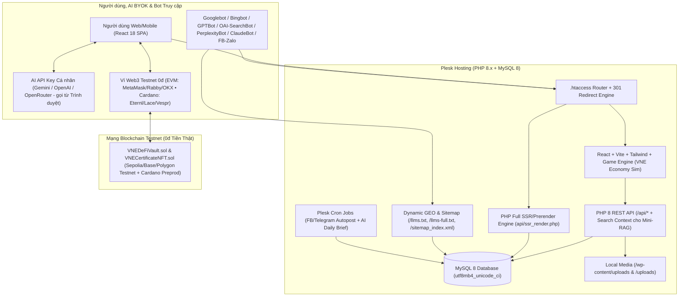

# KẾ HOẠCH TỔNG THỂ CHUYỂN ĐỔI & TÁI CẤU TRÚC VNECONOMICS.COM (v2)

**Từ WordPress → Nền tảng Tri thức & Ứng dụng Số Độc lập (Blog + E-Library + E-Learning + AI BYOK + Game hóa & Web3 Testnet 0đ) Chuẩn SEO • GEO • AEO**

> **Trạng thái hiện tại**: Đang ở bước chốt kế hoạch tổng thể. **Chưa viết hoặc chỉnh sửa bất kỳ mã nguồn ứng dụng nào** cho đến khi có xác nhận cho phép triển khai từ chủ dự án.
>
> **Định hướng triển khai**: Không dùng staging subdomain và **không thu tiền thật**. Toàn bộ quá trình phát triển, di cư dữ liệu (ETL) và kiểm thử được thực hiện tại máy local, sau đó đóng gói production (`vneconomics-production.zip`) đẩy thẳng lên Plesk theo quy trình Cutover 0 phút gián đoạn, giữ nguyên WordPress cũ để Rollback trong dưới 2 phút.

---

## 1. Kiểm kê & Kế hoạch Tận dụng 100% Tài nguyên Sẵn có

Khảo sát trực tiếp từ `https://vneconomics.com/` (WP REST API & Yoast Sitemap) và workspace `c:\Projects\VNEconomics`:

| Tài nguyên hiện có | Quy mô / Chi tiết thực tế | Cách xử lý & Tận dụng trên Nền tảng Mới |
|---|---|---|
| **Bài viết (Blog)** | **216 bài** (12 chuyên mục, 7 thẻ, 51 bình luận) | Giữ nguyên URL `/<slug>/`, làm sạch shortcode Elementor, gom về **5 Topic Pillars**, chạy AI sinh sẵn TL;DR + FAQ phục vụ SEO/GEO/AEO. |
| **Trang tĩnh & Tiện ích** | **62 trang** | Phân loại rõ: giữ & nâng cấp các trang chiến lược; hợp nhất trang thừa và cấu hình 301 Redirect tự động. |
| **5 Trang Dữ liệu Thị trường** | Đã gắn sẵn nguồn nhúng chạy ổn định (0đ API): • `lai-suat-ngan-hang` (2 Google Looker Studio) • `ty-gia-ngoai-te` (Wise + Investing.com + TradingView) • `gia-chung-khoan` (VNINDEX/HNX/UPCOM/VN30) • `gia-vang` (`giavangvietnam.com`) • `gia-crypto` (TradingView) | Giữ nguyên các nguồn dữ liệu sẵn có, bọc lại trong giao diện mới hỗ trợ Dark/Light mode + gắn Schema `Dataset` + nút **"Phân tích bằng AI (BYOK)"** + kết nối vào game Đầu tư mô phỏng. |
| **Từ điển Cardano** | `tu-dien-cardano` (~300 KB dữ liệu thuật ngữ dồn trong 1 trang) | Script ETL tự động tách từng thuật ngữ thành hàng trăm trang đích độc lập `/tu-dien/<term-slug>/` gắn Schema `DefinedTerm` + `FAQPage` chuẩn AEO. |
| **4 Tài sản Cardano & Blockchain VN** | `vietnam-cardano-blockchain-map` (94 KB), `kols-blockchain-crypto-vietnam` (77 KB), `cardano-annual-market-report` (45 KB), `drep` | Nâng cấp thành **Cardano & Web3 Vietnam Hub** có bộ lọc tương tác, Schema `Person`/`Organization` (E-E-A-T/GEO) và kết nối ví Cardano `CIP-30`. |
| **59 Sách & Tài liệu (WooCommerce)** | 59 sản phẩm thuộc 6 danh mục sách (**59/59 đang để 0đ**) | Di cư đủ sang **Thư viện Tri thức `/product/<slug>/`**, phân tầng mở khóa miễn phí hoặc bằng **VNE Points / Crypto Testnet 0đ**. |
| **10 Khóa học (LearnPress LMS)** | 10 khóa học (~546 lượt học viên: Tài chính & Pháp lý Blockchain 343 HV, CBCA 38 HV, MIT, Princeton...) | Di cư sang phân hệ `/course/<slug>/`, tích hợp tiến độ học tập, thưởng VNE Points & đúc chứng chỉ NFT Testnet. |
| **Tài liệu & AI Skills Độc quyền** | 595 tệp media gồm các PDF chuyên khảo của ThS. Trần Thanh Tùng (*Kinh tế số, AI Marketing, Thập kỷ Tài sản số VN*) & 2 gói AI Skills ZIP (`nhan-xet-khoa-luan-ung-dung-verGemini.zip`, `nhan-xet-khoa-luan-nghien-cuu.zip`) | Tải toàn bộ về `/wp-content/uploads/` để không vỡ link ảnh/PDF; dùng 2 gói AI Skills đưa thành **Trợ lý AI BYOK Hỗ trợ Khóa luận & Nghiên cứu** trực tiếp trên web và làm tài nguyên mở khóa VIP. |
| **3 Ngân hàng Đề thi Trắc nghiệm** | • `kiem-tra-kien-thuc-digital-marketing` (~396 KB) • `kiem-tra-kien-thuc-e-marcomme` (~305 KB) • `bai-thi-cuoi-ky-khoa-hoc-tai-chinh-phap-ly-blockchain` (~278 KB, 40 câu) | **Chủ trương của chủ dự án**: Sẽ chuyển hệ thống thi sang `https://staging-store.vneconomics.com/`, do đó **không dựng hệ thống thi nặng trên bản mới**. Tuy nhiên, script ETL sẽ **trích xuất và bảo toàn 100% toàn bộ câu hỏi/đáp án/script ra tệp JSON + SQL sạch (`exports/exam_banks/`)** để bạn import sang `staging-store.vneconomics.com` dễ dàng, kèm bảng cấu hình 301 Redirect sẵn khi cần. |
| **Autopost FB & Telegram** | Có sẵn trong `c:\Projects\VNEconomics` (4 khung giờ/ngày, Gemini Rewriter, WebP→JPG) | Giữ nguyên và nối nguồn `vneconomics.com` sang đọc trực tiếp từ MySQL mới (vẫn giữ `wp_sync.php` cho `marketing2student.com`). |

---

## 2. Kiến trúc Tổng thể Hệ thống

### 2.1. Nâng cấp cốt lõi so với `C:\Projects\yeutrongcay`
| Thành phần | `yeutrongcay` hiện tại | `vneconomics.com` bản nâng cấp |
|---|---|---|
| **Bot Rendering (SEO/GEO)** | `og_render.php` chỉ trả meta OG + mô tả ngắn | **Full PHP SSR Engine (`api/ssr_render.php`)** trả trọn vẹn HTML5 ngữ nghĩa (`<article>`, `<h1>–<h3>`, bảng biểu, FAQ, Breadcrumb, JSON-LD) cho Googlebot & AI Crawlers |
| **GEO & AEO** | Chưa có `/llms.txt` & Answer Box | Động xuất `/llms.txt`, `/llms-full.txt`, Answer-First TL;DR, `FAQPage`, `DefinedTerm` (từ *Từ điển Cardano*), `Dataset`, `Person` |
| **Web3 Multi-chain (0đ)** | Chỉ EVM Testnet (`viem`) | **Multi-chain 100% Testnet**: EVM (`viem` + chặn Mainnet) **+** Cardano (`CIP-30` Preprod/Preview) |
| **Cơ chế Game & Mở khóa** | `gardenGameService` + `karmaService` (Tim) | **`VNE Economy Sim`** (Lazy State Evaluation + Paper Trading gắn giá thật) + **`VNE Points`** + Mở khóa Sách/Prompt/Dataset/NFT Chứng chỉ bằng điểm hoặc Crypto Testnet 0đ |
| **AI BYOK (`userAIService`)** | Chẩn đoán lá cây (Gemini/OpenAI) | Hỗ trợ **Gemini + OpenAI + OpenRouter**, Mini-RAG trên kho dữ liệu VNE, trợ lý đọc bài, phân tích bảng giá thị trường, trợ lý khóa luận từ 2 gói AI Skills sẵn có |

### 2.2. Cấu trúc Phần mềm, Hiệu năng & Khả năng Mở rộng
Để đảm bảo hệ thống tải nhanh, mượt mà trên hạ tầng Plesk và dễ bảo trì/mở rộng khi thêm tính năng mới (Data Lab, Game, Web3, AI):
- **Frontend Modular (Feature-Based Architecture)**:
  - Tổ chức mã nguồn tách bạch theo miền nghiệp vụ: `src/features/{blog,library,academy,market,game,web3,ai,admin}` và lớp dùng chung `src/core/{api,auth,seo,ui}`.
  - Áp dụng **`React.lazy()` code-splitting theo từng route** và cấu hình Vite `manualChunks` tách riêng `vendor-react`, `vendor-web3` (`viem`), `vendor-charts` — giúp người đọc báo thông thường **không phải tải mã Web3 hay biểu đồ**, giữ tốc độ First Load & LCP tối ưu (< 2.0s).
- **Backend PHP 8 Modular & Caching**:
  - Tách lõi dùng chung `api/core/{bootstrap,db,jwt_verify,rate_limit,sanitizer,cache,response}.php` khỏi các endpoint controller mỏng (`posts.php`, `products.php`, `game.php`, `nft.php`...).
  - Bật **File/JSON Response Cache có TTL** cho các endpoint đọc nhiều (`posts`, `pillars`, `glossary`, `market`) kèm cơ chế tự động xóa cache (invalidate) khi Admin thêm/sửa bài viết — giảm tải MySQL tới 80–90% khi traffic tăng đột biến.
- **Tối ưu MySQL cho Quy mô lớn**:
  - Đánh `FULLTEXT INDEX` cho `posts(title, tldr_summary, content_html)` (phục vụ tìm kiếm & Mini-RAG nhanh) và composite index `(status, pillar_id, published_at)`.
  - API danh sách tuyệt đối **không** select cột `content_html` nặng, chỉ truy vấn ở trang chi tiết; dùng phân trang chuẩn để sẵn sàng mở rộng lên hàng chục nghìn bài viết mà không chậm truy vấn.

---

## 3. Tái cấu trúc Thông tin (IA) chuẩn SEO • GEO • AEO

### 3.1. Hợp nhất 12 chuyên mục cũ thành 5 Trụ cột Tri thức (Topic Pillars)
| Trụ cột mới (Pillar) | URL chuẩn mới | Gộp từ chuyên mục / trang WP cũ (HTTP 301 Redirect) |
|---|---|---|
| **1. Kinh tế số & Chuyển đổi số** | `/kinh-te-so/` | `chuyen-doi-so`, `ung-dung-cong-nghe`, `kinh-te-ky-thuat-so` |
| **2. Blockchain & Tài sản số** | `/blockchain-tai-san-so/` | `kien-thuc-blockchain` (96 bài), `tin-tuc-tien-ma-hoa` (91 bài), `cardano-ada`, `drep`, `khoa-hoc-blockchain` |
| **3. AI & Công nghệ mới** | `/ai-cong-nghe/` | `ung-dung-ai` (6 bài), các bài AI/Robot/LSTM |
| **4. Digital Marketing & Tăng trưởng** | `/digital-marketing/` | `digital-marketing` (5 bài), `quang-cao` (3 bài) |
| **5. Nghiên cứu Khoa học & Học thuật** | `/nghien-cuu-khoa-hoc/` | `phuong-phap-nghien-cuu`, `mo-hinh-nghien-cuu`, `gs-nguyen-van-tuan` |

> **Bảo toàn 100% URL chi tiết**: Toàn bộ 216 bài viết giữ nguyên `/<slug>/`, 59 sách giữ nguyên `/product/<slug>/`, 10 khóa học giữ nguyên `/course/<slug>/`, 5 trang thị trường giữ nguyên `/gia-vang/`, `/gia-crypto/`, `/ty-gia-ngoai-te/`, `/lai-suat-ngan-hang/` (& `/lai-suat-vay-ngan-hang/`), `/gia-chung-khoan/`. Các trang trung tâm mới gồm: `/thu-vien-sach/`, `/hoc-vien/`, `/tu-dien/<term-slug>/`, `/thi-truong/`, `/learn-and-earn/` (Game & Web3 Sandbox), `/cardano-hub/`, `/ai-lab/`.

---

## 4. Hệ thống Kỹ thuật SEO • GEO • AEO

1. **Tầng SEO Kỹ thuật**:
   - **Full PHP SSR (`api/ssr_render.php`)**: `.htaccess` định tuyến bot (`Googlebot`, `Bingbot`, `GPTBot`, `OAI-SearchBot`, `PerplexityBot`, `ClaudeBot`, `Google-Extended`, `facebookexternalhit`, `Zalo`, `TelegramBot`, `Twitterbot`) sang HTML đầy đủ nội dung + Canonical + OpenGraph 1200×630 + bắt buộc header `Vary: User-Agent`.
   - **Sitemap XML Động (`/sitemap_index.xml`)**: Giữ chuẩn Yoast gồm `post-sitemap.xml`, `product-sitemap.xml`, `course-sitemap.xml`, `glossary-sitemap.xml`, `market-sitemap.xml`.
   - **Quản lý Redirect 301 & Log 404**: Bảng `redirects` xử lý chuyển hướng cũ + `not_found_logs` bắt lỗi theo thời gian thực để fix 1 chạm trong Admin.
2. **Tầng GEO (AI Search)**:
   - **`/llms.txt` & `/llms-full.txt` (`api/llms.php`)**: Bản đồ tri thức Markdown sạch cho AI crawler.
   - **E-E-A-T & Citation Block**: Trang Tác giả (`/tac-gia/<slug>/`) kèm JSON-LD `Person`; mọi bài viết có `dateModified`, nguồn tham khảo và khung trích dẫn APA/BibTeX.
   - **`robots.txt` thân thiện AI**: Cho phép rõ ràng các AI search bot, chặn `/admin`, `/api/admin`.
3. **Tầng AEO (Answer Engine) & Ranh giới Tĩnh/Động**:
   - **Server-side (dùng Gemini Key website 1 lần & lưu cứng MySQL)**: Batch sinh *Answer-First TL;DR (40–60 từ)* và *FAQ 3–5 câu* cho 216 bài viết cũ (có duyệt trong Admin), xuất JSON-LD (`Article`/`NewsArticle`, `FAQPage`, `DefinedTerm`, `Dataset`, `Product`, `Course`, `Person`, `BreadcrumbList`), và chạy *AI Daily Brief* mỗi sáng.
   - **Client-side (dùng AI Key BYOK của người dùng)**: Chỉ phục vụ tương tác cá nhân hóa trên trình duyệt (không ảnh hưởng dữ liệu index).

---

## 5. Thiết kế Các Phân hệ Chính (Mô hình 0đ Tiền Thật)

### 5.1. Thư viện Tri thức & Cơ chế Mở khóa (Không bán tiền thật)
Loại bỏ hoàn toàn cổng thanh toán tiền thật. Toàn bộ 59 đầu sách/tài liệu, PDF chuyên khảo, 2 gói AI Skills và bộ Dataset được phân tầng mở khóa bằng **VNE Points** hoặc **Crypto Testnet 0đ**:
- **Mức Mở (Free — chỉ cần đăng nhập / kết nối ví)**: Các đầu sách phổ thông và giáo trình mở OER → nhận link tải có chữ ký tạm thời (signed download token).
- **Mức Nâng cao (Unlock bằng VNE Points hoặc 1 giao dịch Testnet 0đ)**: Các tài liệu chuyên khảo gốc (*Thập kỷ Tài sản số VN*, *AI Marketing*), 2 gói AI Skills khóa luận, Bộ Prompt AI Pro và Dataset nghiên cứu.

### 5.2. Hệ thống Game hóa `VNE Economy Sim` & DeFi/DAO Sandbox (Kế thừa `yeutrongcay`)
Chuyển thể trực tiếp kiến trúc đã kiểm chứng từ `gardenGameService.ts`, `karmaService.ts` và `AgriDeFiVault.sol`:
- **Hệ thống Điểm Tri thức `VNE Points` (tương đương `karmaService`)**:
  - Kiếm điểm qua: điểm danh hàng ngày, đọc trọn bài viết, hoàn thành bài học trong 10 khóa học, đóng góp bình luận chất lượng, thực hiện giao dịch Testnet 0đ.
  - 4 Cấp bậc Danh hiệu: *Tân binh Kinh tế số → Nhà Phân tích Trẻ → Chuyên gia Tài sản số → Kiến trúc sư Kinh tế số*.
- **Trò chơi `VNE Economy Sim` (Lazy State Evaluation — không tốn tải server)**:
  - Người dùng dùng VNE Points mua/nâng cấp **Tài sản Số** (*Node Validator, Cụm GPU AI, Gian hàng TMĐT, Trái phiếu Xanh*) sinh điểm thụ động theo thời gian, kèm chỉ số hiệu suất/bảo trì giống cơ chế sinh trưởng của `yeutrongcay`.
  - **Đầu tư Mô phỏng (Paper Trading)** gắn trực tiếp với **giá thật** từ 5 trang Market Hub (Vàng, Crypto, Tỷ giá, Chứng khoán).
- **Web3 Multi-chain 100% Testnet & Smart Contracts Sandbox**:
  - **EVM (`viem` + EIP-1193)**: Sepolia, Base Sepolia, Polygon Amoy, BSC Testnet, Arbitrum Sepolia — giữ nguyên cơ chế **`isMainnetDanger` cảnh báo và chặn Mainnet** của `yeutrongcay` để đảm bảo 0đ tiền thật.
  - **Cardano (`CIP-30`)**: Eternl, Lace, Vespr, Nami, Typhon, Yoroi trên Preprod/Preview Testnet (đọc số dư tADA, trạng thái dRep, ký xác thực CIP-8).
  - **2 Smart Contracts Sandbox (`contracts/`)**:
    1. `VNEDeFiVault.sol`: Staking VNE/Token Testnet nhận lợi suất mô phỏng + **Biểu quyết DAO cộng đồng** (chọn chủ đề sách/báo cáo/khóa học mới).
    2. `VNECertificateNFT.sol`: Hợp đồng đúc NFT chuẩn ERC-721 (kế thừa kiến trúc `PlantPassportNFT.sol` không phụ thuộc thư viện ngoài).
- **Cơ chế Đúc NFT On-chain Testnet (0đ Tiền Thật)**:
  - **3 Loại NFT hỗ trợ đúc**:
    1. **NFT Hộ chiếu Kinh tế số (`VNE-PASSPORT` — Dynamic ERC-721)**: Tự động cập nhật cấp bậc/mốc thành tựu theo `VNE Points` và `VNE Economy Sim` (kế thừa sự kiện `GrowthMilestoneRecorded` của `PlantPassportNFT.sol`).
    2. **NFT Chứng chỉ Khóa học (`VNE-CERT`)**: Mở khóa đúc khi hoàn thành khóa học trong 10 khóa học, gắn `sha256Proof` xác thực và trang tra cứu công khai `/verify/<token-id>`.
    3. **NFT Bằng chứng Học thuật / Tài sản Game (`VNE-PROOF`)**: Đúc chứng nhận SHA-256 cho thành tựu nghiên cứu hoặc tài sản cấp cao đạt ngưỡng trong `VNE Economy Sim`.
  - **Quy trình Đúc NFT 4 bước an toàn**:
    1. Hệ thống kiểm tra điều kiện mở khóa (mốc `VNE Points`, hoàn thành khóa học, hoặc mốc tài sản game).
    2. Backend PHP cấp `nonce` voucher chống Replay Attack (`nft_mint_vouchers`), sinh `sha256Proof` và JSON Metadata + ảnh thẻ NFT động (`api/nft_metadata.php`).
    3. Người dùng ký giao dịch On-chain 100% Testnet: **EVM Testnet** (`VNECertificateNFT.sol` trên Sepolia / Base Sepolia / Polygon Amoy, chặn Mainnet bằng `isMainnetDanger`) hoặc **Cardano Testnet** (metadata chuẩn **CIP-25** qua ví CIP-30).
    4. Lưu `token_id`, `tx_hash`, `network`, `contract_address`, `sha256_proof` vào bảng `user_nfts`; hiển thị trên Hồ sơ cá nhân kèm link tra cứu trực tiếp Block Explorer (Etherscan Sepolia / BaseScan / Cardanoscan Preprod) và trang `/verify/<id>`.

### 5.3. Hệ thống AI BYOK (Bring Your Own Key — Triển khai ngay Giai đoạn 3–4)
Kế thừa và nâng cấp từ `userAIService.ts` của `yeutrongcay`:
- **3 Nhà cung cấp chuẩn CORS chạy trực tiếp từ Trình duyệt**: **Google Gemini** (mặc định `gemini-2.5-flash`), **OpenAI** (`gpt-4o-mini`), và **OpenRouter** (1 key dùng được cả Claude, GPT, DeepSeek, Llama). Cho phép tự nhập Model ID, lưu 100% ở `localStorage`, nút *Kiểm tra kết nối* và *Xóa Key 1 chạm*.
- **Mini-RAG không cần Vector DB**: Khi người dùng hỏi **VNE AI Research Copilot**, trình duyệt gọi `api/search.php?format=context` (MySQL Full-text Search) lấy Top 3–5 đoạn trích thực tế từ 216+ bài viết/59 sách/thị trường làm ngữ cảnh gửi lên AI Key của người dùng.
- **Công cụ AI theo Ngữ cảnh**:
  - Trên **Bài viết / Bài học**: Tóm tắt 3 ý cốt lõi, giải thích cho người mới, tạo Flashcard & 5 câu ôn tập.
  - Trên **5 Trang Dữ liệu Thị trường**: Nút *"Phân tích biến động hôm nay bằng AI"* đọc trực tiếp bảng số liệu hiện tại.
  - **Trợ lý Đánh giá Khóa luận & Nghiên cứu (tận dụng 2 gói AI Skills sẵn có)** + **Thư viện Prompt AI thực chiến** chạy trực tiếp bằng key người dùng.
- **Fallback thân thiện**: Chưa nhập key vẫn đọc/chơi game/xem dữ liệu thị trường/dùng máy tính tài chính bình thường, kèm hướng dẫn 3 bước lấy Gemini API Key miễn phí.

### 5.4. Học viện 10 Khóa học, Cardano Hub & Admin CMS + Autopost
- **Học viện (`/hoc-vien/`)**: Di cư 10 khóa học LearnPress, lưu tiến độ hoàn thành (`user_enrollments`), hoàn thành khóa học nhận VNE Points + quyền đúc Chứng chỉ NFT Testnet.
- **Cardano Hub (`/cardano-hub/`)**: Hợp nhất *Vietnam Cardano Map*, *Danh bạ KOLs*, *Cardano Annual Market Report* và *Cổng dRep*.
- **Admin CMS & Autopost**: Quản lý bài viết (chấm điểm SEO/GEO/AEO + nút AI tạo TL;DR/FAQ), Quản lý Sách/Khóa học/Từ điển, Quản lý Redirect 301 & Log 404, và Bảng điều khiển Autopost Facebook/Telegram đọc thẳng từ MySQL mới.

### 5.5. Tiêu chuẩn Thiết kế UI/UX (Design System Tạp chí Kinh tế Số)
- **Phong cách thẩm mỹ Editorial Financial-Tech**: Tối giản, tin cậy, giàu tính biên tập (tinh thần *Financial Times / Bloomberg / Linear*), hỗ trợ mượt mà **Light Mode** (nền trắng sứ ấm dịu mắt) và **Dark Mode** (xanh đen tài chính sâu), đảm bảo độ tương phản màu chuẩn **WCAG AA (≥ 4.5:1)**.
- **Typography & Dữ liệu Số**: Bộ font tối ưu dấu tiếng Việt (`Be Vietnam Pro` / `Inter` cho UI & nội dung + `Merriweather` / `Newsreader` tùy chọn cho tiêu đề bài phân tích); bắt buộc dùng `tabular-nums` cho toàn bộ bảng giá thị trường, số dư game và điểm `VNE Points` để các cột số thẳng hàng tuyệt đối.
- **Trải nghiệm Đọc & Mobile-First**: Cột nội dung bài viết giới hạn độ rộng tối ưu (`65–72ch`), có thanh tiến độ đọc, Mục lục (TOC) nổi gọn bên cạnh, **Skeleton Loading** giữ cố định khung hình (chống giật CLS ≈ 0), và thanh điều hướng đáy (**Mobile Bottom Nav**) cho điện thoại.
- **Tách bạch Không gian Trải nghiệm**: Thanh Header giữ gọn gàng cụm `[🔑 AI Key] + [Ví Testnet] + [Tài khoản / VNE Points]`; giữ không gian đọc tin/nghiên cứu nghiêm túc, tập trung và đưa hiệu ứng Game hóa (`VNE Economy Sim`) cùng Web3 Sandbox vào phân khu riêng (`/learn-and-earn/`, `/cardano-hub/`) để không gây rối mắt cho độc giả truyền thống.

---

## 6. Kiến trúc Bảo mật, An ninh mạng & Chống Tấn công (Cloudflare + Firebase + OWASP)

### 6.1. Tầng Biên — Cloudflare (Đứng trước Plesk)
- **Ẩn IP gốc Plesk & Chống DDoS**: Toàn bộ DNS `vneconomics.com` đi qua Cloudflare Proxy (đám mây cam), cấu hình firewall trên Plesk chỉ cho phép dải IP của Cloudflare truy cập trực tiếp HTTP/HTTPS để chặn tấn công thẳng vào IP gốc.
- **WAF, Bot Management & Rate Limiting**:
  - Bật **Cloudflare WAF Managed Rules** chặn tự động các mẫu tấn công SQLi, XSS, LFI, RCE phổ biến.
  - Bật **Bot Fight Mode** (nhưng giữ quy tắc **Allow** cho các bot đã xác minh như `Googlebot`, `Bingbot`, `GPTBot`, `OAI-SearchBot`, `PerplexityBot`, `ClaudeBot`, `facebookexternalhit`, `Zalo`).
  - Thiết lập **Rate Limiting Rules** bảo vệ các endpoint nhạy cảm (`/api/auth/*`, `/api/admin/*`, `/api/comments`, `/api/unlock`, `/api/nft/*`).
- **Chống Spam không gây phiền bằng Cloudflare Turnstile**: Gắn widget xác thực vô hình/1-click Turnstile vào form Bình luận, Đăng ký/Liên hệ và cấp Voucher đúc NFT.
- **Quy tắc Cache Cloudflare bắt buộc với PHP SSR**: Chỉ cache các tệp tĩnh (`/assets/*`, `/wp-content/uploads/*`, `/uploads/*`); **Bypass Cache đối với HTML và `/api/*`** (để header `Vary: User-Agent` hoạt động chuẩn xác, tuyệt đối không để người dùng thật nhận nhầm trang HTML dành cho Bot).

### 6.2. Tầng Xác thực — Firebase Auth & Chữ ký Web3 (Xác minh phía Server)
- **Xác minh Firebase ID Token (`JWT RS256`) tại PHP Backend**: Tuyệt đối **không** tin `user_id` hay `email` gửi trần từ trình duyệt; mọi API yêu cầu đăng nhập đều bắt buộc gửi `Authorization: Bearer <Firebase_ID_Token>` và PHP xác minh chữ ký số bằng Google Public Keys (cache cục bộ 6 giờ).
- **Phân quyền RBAC & Bảo vệ Admin 2 lớp**: Phân tách `guest`, `member`, `editor`, `admin`; trang `/admin` và `/api/admin/*` yêu cầu đồng thời **Firebase Admin UID** + **Admin Secret Header** (có thể khóa thêm IP/Email qua **Cloudflare Zero Trust Access**).
- **Xác thực Ví Web3 bằng Chữ ký Số (0đ Gas)**: Kiểm tra quyền sở hữu ví qua **SIWE (Sign-In with Ethereum)** cho EVM và **CIP-8** cho Cardano kèm `nonce` ngẫu nhiên hết hạn sau 5 phút.

### 6.3. Phòng thủ Tầng Ứng dụng (OWASP Top 10, Anti-Cheat & Bảo vệ BYOK)
- **Chống XSS (Cross-Site Scripting)**: Làm sạch toàn bộ HTML migrate từ WordPress và nội dung người dùng bằng **DOMPurify** ở Frontend + HTML Whitelist Sanitizer ở PHP Backend. Bật header **`Content-Security-Policy` (CSP)** chặt chẽ (chỉ whitelist domain nhúng hợp lệ: Looker Studio, TradingView, Wise, Investing, `giavangvietnam.com`, Firebase, Gemini/OpenAI/OpenRouter) cùng `X-Frame-Options: SAMEORIGIN`, `X-Content-Type-Options: nosniff`, `Strict-Transport-Security`.
- **Chống SQL Injection**: 100% truy vấn dùng **PDO Prepared Statements** với `PDO::ATTR_EMULATE_PREPARES => false`.
- **Chống CSRF, CORS & Bảo vệ Tệp tin**: Khóa `Access-Control-Allow-Origin` đúng domain `https://vneconomics.com`; chặn thực thi PHP tuyệt đối trong `/uploads/` và `/wp-content/uploads/` qua `.htaccess`; kiểm tra Magic Bytes (MIME thật) nếu cho phép upload ảnh; tệp PDF/AI Skills mở khóa VIP tải qua **PHP Signed Download Token** có thời hạn (không lộ URL tĩnh trực tiếp).
- **Chống Gian lận Game & Đúc NFT (Anti-Cheat)**: Không tin số điểm từ `localStorage`; toàn bộ logic cộng/trừ `VNE Points`, giới hạn cooldown theo ngày, tính toán lại `Lazy State Evaluation` và cấp `nonce` 1 lần (`nft_mint_vouchers`) đều được **kiểm chứng ở PHP Server** trước khi cho phép mở khóa tài liệu hoặc đúc NFT.
- **Bảo vệ BYOK AI Key của Người dùng**: Ngoài `localStorage`, cung cấp tùy chọn **"Chỉ lưu cho phiên hiện tại (`sessionStorage`)"** cho người dùng ngồi máy công cộng; kết hợp CSP chặt để ngăn script lạ đọc trộm key; tuyệt đối không gửi hay ghi log AI Key lên server hoặc Google Analytics.
- **An toàn Hạ tầng Plesk**: Đặt `api/config.php` ra thư mục cha ngoài `httpdocs` (hoặc khóa bằng `.htaccess`), tắt `display_errors` trên môi trường production, và thiết lập lịch sao lưu MySQL tự động hàng ngày.

---

## 7. Thiết kế Cơ sở Dữ liệu MySQL

Chạy trên **1 MySQL Database** (`utf8mb4_unicode_ci`) trên Plesk:
1. `users` — `firebase_uid`, `email`, `evm_address`, `cardano_address`, `role`, `display_name`, `avatar_url`, `bio`, `credentials_json`.
2. `pillars` & `tags` — 5 trụ cột nội dung và thẻ phân loại kèm SEO metadata.
3. `posts` — 216+ bài viết & trang (`wp_id`, `type`, `slug`, `title`, `tldr_summary`, `content_html`, `faq_json`, `pillar_id`, `author_id`, `featured_image`, `seo_title`, `seo_desc`, `status`, `views`, `published_at`, `updated_at`).
4. `glossary_terms` — Hàng trăm thuật ngữ tách từ `tu-dien-cardano` và *Từ điển Blockchain* (`slug`, `term`, `short_definition`, `full_explanation`, `related_pillar_id`).
5. `comments` — 51+ bình luận migrate từ WP + bình luận mới có kiểm duyệt.
6. `products` & `unlock_logs` — 59+ sách/tài liệu, PDF chuyên khảo, AI Skills (`wp_id`, `slug`, `title`, `category_slug`, `unlock_type`: `free|points|testnet_tx`, `points_cost`, `file_path`, `download_count`) + lịch sử mở khóa của user.
7. `courses`, `course_lessons`, `user_enrollments` — 10 khóa học LearnPress và tiến độ học viên.
8. `user_points`, `user_point_events`, `sim_portfolios`, `sim_assets`, `nft_mint_vouchers`, `user_nfts` — Hệ thống điểm `VNE Points`, Game `VNE Economy Sim` (Lazy State Evaluation + Paper Trading), Voucher Nonce chống replay và lịch sử NFT đã đúc On-chain Testnet (`token_id`, `tx_hash`, `network`, `contract_address`, `sha256_proof`).
9. `market_snapshots` — Lưu cache & lịch sử biến động 5 trang thị trường (phục vụ biểu đồ, AI phân tích và Paper Trading).
10. `redirects` & `not_found_logs` — Bản đồ 301 Redirect từ mọi URL cũ (kể cả link sẵn sàng trỏ các trang thi sang `staging-store.vneconomics.com` khi cần) + log 404 thời gian thực.
11. `social_autopost_*` — Giữ nguyên các bảng hàng đợi của hệ thống Facebook & Telegram Autopost hiện có.

---

## 8. Lộ trình Triển khai 5 Giai đoạn (Build & Test Local → Deploy Plesk)

| Giai đoạn | Phạm vi công việc & Sản phẩm bàn giao | Tiêu chí Nghiệm thu (Definition of Done) |
|---|---|---|
| **Giai đoạn 1: Nền móng, Kiến trúc & Bảo mật Lõi** | Dựng khung Frontend Modular (`src/features/*`, `src/core/*`, code-splitting Vite) và Backend PHP Modular (`api/core/*`, cache TTL, PDO Prepared Statements, xác minh Firebase JWT RS256, CSP/Security Headers) trong `c:\Projects\VNEconomics` (giữ nguyên toàn bộ code Autopost); Design System Editorial Financial-Tech (Light/Dark mode, `tabular-nums`); viết đầy đủ SQL migrations có đánh index tối ưu. | `npm run typecheck` và `npm run build` pass (bundle tách chunk gọn nhẹ); schema MySQL và tầng xác thực JWT chạy sạch tại local. |
| **Giai đoạn 2: Di cư Dữ liệu WordPress (ETL) & Làm sạch XSS** | Script ETL kéo 216 bài viết, 62 trang, 59 sách, 10 khóa học, 51 bình luận, Yoast meta và tải 595 tệp media về `/wp-content/uploads/`; làm sạch shortcode Elementor & sanitize HTML chống XSS; tách `tu-dien-cardano` thành `glossary_terms`; **trích xuất trọn vẹn 3 ngân hàng đề thi ra `exports/exam_banks/`** (JSON + SQL sạch cho `staging-store.vneconomics.com`); gán 5 Pillar và sinh bảng `redirects` 301. | 100% nội dung, media, từ điển hiển thị chuẩn tại local; gói `exports/exam_banks/` đầy đủ 100% câu hỏi/đáp án. |
| **Giai đoạn 3: Core Web App + BYOK AI + Game VNE Economy Sim** | Trang chủ biên tập, 5 Pillar Hub, trang bài viết (TOC, TL;DR, FAQ, Citation Box, DOMPurify, Skeleton UI), Thư viện Sách & cơ chế Mở khóa 0đ (Signed Download Token), Học viện 10 khóa học, Từ điển AEO, **AI BYOK (Copilot Mini-RAG, Trợ lý bài viết, Trợ lý Khóa luận từ 2 AI Skills, tùy chọn `localStorage`/`sessionStorage`)**, **VNE Points & Game `VNE Economy Sim` (Anti-Cheat server-side)**, và Admin CMS. | Đọc bài, tìm kiếm, mở khóa tài liệu bằng VNE Points, chơi game mô phỏng, chạy AI BYOK và quản trị Admin thông suốt trên Desktop & Mobile. |
| **Giai đoạn 4: Web3 Testnet Multi-chain, Market Hub & SEO/GEO/AEO Engine** | Ví EVM (`viem` + chặn Mainnet) + Cardano (`CIP-30` Testnet), Smart Contracts Sandbox (`VNEDeFiVault.sol`, `VNECertificateNFT.sol`), luồng đúc NFT (`api/nft_metadata.php`, voucher nonce, trang xác thực `/verify/<id>`), Cardano Hub; 5 trang Market Hub (giữ nguồn nhúng sẵn + AI phân tích); hoàn thiện `api/ssr_render.php`, `/llms.txt`, `/llms-full.txt`, `/sitemap_index.xml`, nối Autopost vào DB mới và AI batch làm giàu 216 bài cũ. | Kết nối ví EVM & Cardano Testnet thành công; đúc và tra cứu NFT Testnet (`/verify/<id>`) thành công; giả lập `Googlebot`, `GPTBot`, `Facebook Bot` trả HTML đầy đủ + Rich Schema hợp lệ 0 lỗi. |
| **Giai đoạn 5: Kiểm thử Bảo mật, Cloudflare & Cutover lên Plesk** | Test tự động 100% URL cũ từ sitemap WP (đảm bảo `200` hoặc `301`, 0 lỗi `404`); kiểm tra CSP, Turnstile, Rate Limit & tải trang; đóng gói `vneconomics-production.zip` bằng PowerShell script; triển khai lên Plesk + cấu hình Cloudflare WAF/Bot/Cache Rules theo quy trình Cutover an toàn bên dưới. | 100% URL cũ hợp lệ; Cloudflare & Plesk hoạt động đồng bộ (Bot SSR không bị cache nhầm); Autopost đúng giờ; Google Search Console nhận `sitemap_index.xml`. |

### Quy trình Cutover Zero-Downtime & Rollback dưới 2 phút trên Plesk
1. **Backup nguyên trạng WordPress**: Sao lưu mã nguồn `httpdocs` và database WordPress cũ trước giờ chuyển đổi; giữ nguyên trên server ít nhất 30 ngày.
2. **Đẩy bản mới lên thư mục song song**: Upload & giải nén `vneconomics-production.zip` vào `/httpdocs_v2/`, import DB mới và cấu hình `api/config.php` (đặt ngoài `httpdocs`).
3. **Đồng bộ delta lần cuối**: Chạy lại ETL kéo nốt bài viết/bình luận mới phát sinh tới giờ G.
4. **Chuyển Document Root & Kích hoạt Cloudflare**: Đổi Document Root của `vneconomics.com` trong Plesk từ `/httpdocs` sang `/httpdocs_v2` vào khung giờ thấp điểm (01:00–03:00 sáng); bật Cloudflare WAF, Turnstile và Cache Rules (Bypass HTML/API, giữ `Vary: User-Agent`).
5. **Rollback khẩn cấp**: Đổi Document Root ngược lại `/httpdocs` trong Plesk → WordPress cũ hoạt động lại sau **dưới 2 phút**.
6. **Giám sát 14 ngày**: Submit `/sitemap_index.xml` lên Google Search Console & Bing Webmaster; theo dõi `not_found_logs`, Cloudflare Security Events và tốc độ Core Web Vitals hàng ngày.

### Lộ trình Mở rộng Nâng cao (Pha 2 — Sau khi Cutover ổn định 2–4 tuần)
1. **Data Analytics Lab Nâng cao**: Biểu đồ tương quan đa lớp cho xuất PNG/CSV có watermark `vneconomics.com`, bộ công cụ tính toán tài chính/ROI chuyên sâu, kho **Open Economic Datasets** (CSV/JSON kèm hướng dẫn Python/R/SPSS/SmartPLS).
2. **Content Moats cho GEO**: Xuất bản **Báo cáo Dữ liệu Gốc theo Quý** (*Tài sản số VN, AI trong Marketing & SME*), các **Ma trận So sánh & Xếp hạng** (`<table>` chuẩn ngữ nghĩa) và **Case Study số liệu thực tế**.
3. **Chuyển tiếp Ngân hàng Đề thi**: Kết nối 301 Redirect các trang thi cũ sang `https://staging-store.vneconomics.com/` khi hệ thống thi bên đó hoàn tất.

---

## 9. Bước Tiếp Theo

Toàn bộ kế hoạch đã được cập nhật đầy đủ tại đây. Khi bạn sẵn sàng, chỉ cần nhắn **"Cho phép bắt đầu Giai đoạn 1"**, tôi sẽ bắt tay vào triển khai từng bước và kiểm thử kỹ lưỡng tại local trước khi đóng gói.
